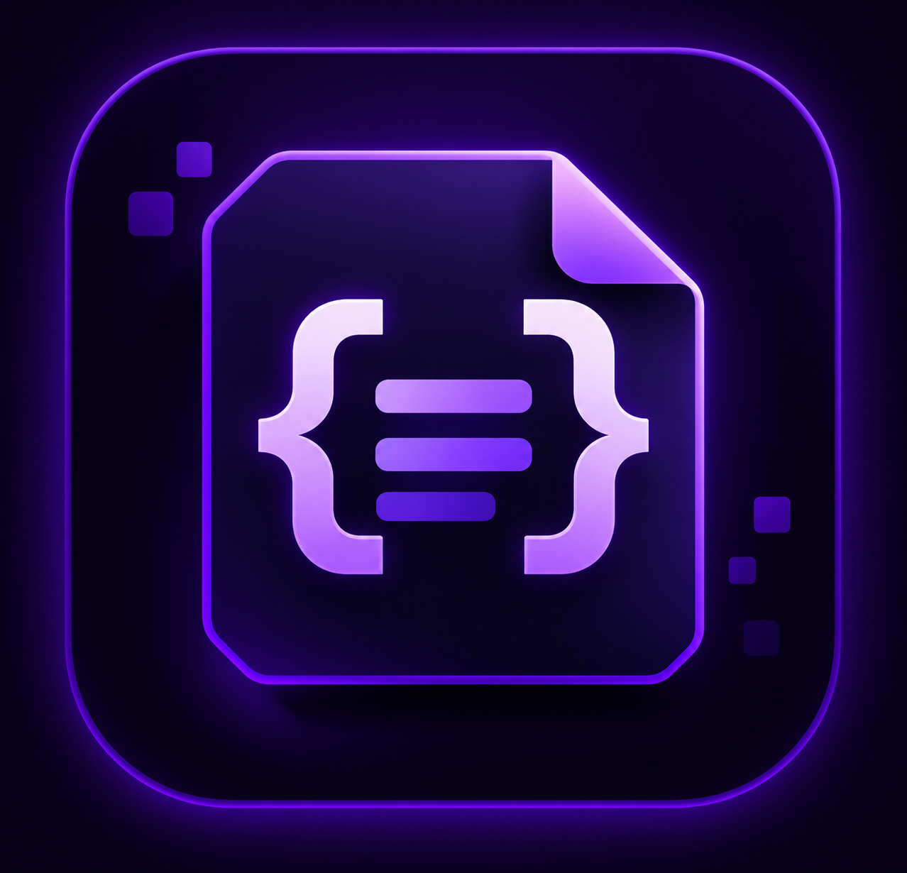

    

 
 

<h1 align="center"> Jason Estúdio </h1>

 📝 Português

 Sobre o Projeto

O Json Estúdio é um aplicativo desktop para Windows que funciona como um visualizador e validador de documentos JSON. Ele permite que você abra, visualize e compare arquivos JSON de forma prática e organizada.

 O que faz
- Editor JSON: Visualize e edite documentos JSON com realce de sintaxe
- Validador JSON Schema: Valide seus documentos contra contratos JSON Schema (draft-07)
- Comparador de Documentos: Compare dois documentos JSON lado a lado e veja diferenças
- Conversor de Formatos: Converta JSON para YAML ou XML
- Preferências: Configure a indentação do documento (2 espaços, 4 espaços ou tab)

 Tecnologias Utilizadas
- React 19 - Interface do usuário
- Vite 8 - Build tool e dev server
- Tailwind CSS 4 - Styling
- Electron - Framework para aplicativos desktop multiplataforma
- Electron Builder - Geração de executáveis portáteis (.exe)

 Plataforma
- Windows x64 - Executável portátil (.exe) para Windows de 64 bits

---

 📄 English

About the Project

Json Estúdio is a Windows desktop application that serves as a JSON document viewer and validator. It allows you to open, view, and compare JSON files in a practical and organized way.

 What it does
- JSON Editor: View and edit JSON documents with syntax highlighting
- JSON Schema Validator: Validate documents against JSON Schema contracts (draft-07)
- Document Comparator: Compare two JSON documents side by side and see differences
- Format Converter: Convert JSON to YAML or XML
- Preferences: Configure document indentation (2 spaces, 4 spaces, or tab)

 Technologies Used
- React 19 - User interface
- Vite 8 - Build tool and dev server
- Tailwind CSS 4 - Styling
- Electron - Framework for cross-platform desktop applications
- Electron Builder - Generation of portable executables (.exe)

 Platform
- Windows x64 - Portable executable (.exe) for 64-bit Windows

---

 📦 Quick Start

O executável já está disponível neste repositório.
- Jason Estúdio 1.0.0.exe - Aplicativo completo para Windows x64

Basta dar duplo clique no arquivo para iniciar. Não é necessário instalação - é um executável portátil.
